<div align="center">



<br/>

<a href="https://github.com/MsDroid?tab=followers"></a>
<a href="https://github.com/MsDroid?tab=repositories"></a>

<a href="https://thedroidsoft.com/"></a>

<br/><br/>

<a href="https://git.io/typing-svg">
  
</a>

</div>

<br/>

<div align="center">
  
</div>

<br/>

## `{ ⚡ about_me }`

```json
{
  "name": "Manoranjan Singh",
  "handle": "MsDroid",
  "company": "TheDroidSoft",
  "location": "Ranchi, Jharkhand, India",
  "currentlyBuilding": "Flutter apps",
  "currentlyLearning": "Cyber Security",
  "askMeAbout": ["Flutter", "Dart", "Laravel", "Android"],
  "openToCollab": ["Android Development", "Cross-platform Development"],
  "funFact": "I debug with console.log and pure hope"
}
```

<br/>

## `< 🧰 tech_stack />`

<div align="center">

**📱 Mobile**


**🌐 Web & Backend**


**🔧 Tools & More**


</div>

<br/>

## `📈 levelling_up.sh`

```text
Flutter & Dart    ▰▰▰▰▰▰▰▰▰▱   Daily driver
Android / Kotlin  ▰▰▰▰▰▰▰▰▱▱   Still my first love
Laravel / PHP     ▰▰▰▰▰▰▰▱▱▱   Backends that behave
Node & Express    ▰▰▰▰▰▰▱▱▱▱   Growing
Cyber Security    ▰▰▰▱▱▱▱▱▱▱   Loading... 🔐
```

<br/>

## `🚀 featured_projects`

<table>
  <tr>
    <td width="50%" valign="top">
      <h3>🎵 Music Streaming App</h3>
      <p>A Flutter music player with <b>background playback</b>, so the music keeps going even when the app is minimized.</p>
      
      
      <br/><br/>
      <a href="https://github.com/MsDroid/music_streaming_app_with_background_play">➜ View project</a>
    </td>
    <td width="50%" valign="top">
      <h3>🛒 Ecom2Project</h3>
      <p>E-commerce web application built with <b>Laravel</b> and Blade templates.</p>
      
      
      <br/><br/>
      <a href="https://github.com/MsDroid/ecom2project">➜ View project</a>
    </td>
  </tr>
  <tr>
    <td width="50%" valign="top">
      <h3>✨ Stunning Landing Page</h3>
      <p>A clean, modern and responsive landing page design.</p>
      
      
      <br/><br/>
      <a href="https://github.com/MsDroid/stunning_landing-page">➜ View project</a>
    </td>
    <td width="50%" valign="top">
      <h3>🎨 HTML-CSS-JS Templates</h3>
      <p>A collection of handcrafted front-end template designs.</p>
      
      
      <br/><br/>
      <a href="https://github.com/MsDroid/Html_css_js-Template_design">➜ View project</a>
    </td>
  </tr>
</table>

<br/>

## `📊 github_analytics`

<div align="center">


</div>

<br/>

## `🐍 contribution_snake`

<div align="center">
  <picture>
    <source media="(prefers-color-scheme: dark)"  srcset="https://raw.githubusercontent.com/MsDroid/MsDroid/output/github-snake-dark.svg"/>
    <source media="(prefers-color-scheme: light)" srcset="https://raw.githubusercontent.com/MsDroid/MsDroid/output/github-snake.svg"/>
    
  </picture>
</div>

<br/>

## `🤝 connect.init()`

<div align="center">

<a href="https://thedroidsoft.com/"></a>
<a href="mailto:manoranjansngh77@gmail.com"></a>
<!-- apna LinkedIn ID yahan daalo -->
<a href="https://www.linkedin.com/in/YOUR-LINKEDIN-ID/"></a>

<br/><br/>

<i>"First, solve the problem. Then, write the code."</i>

<br/>


</div>
